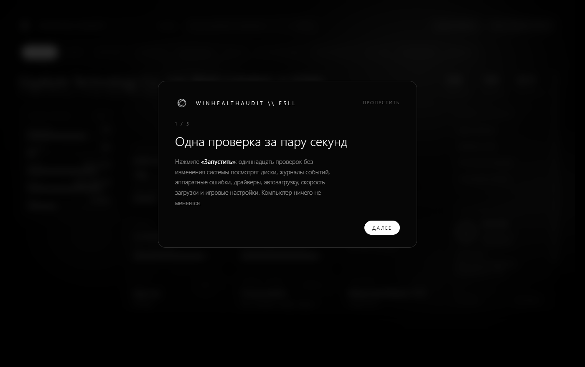
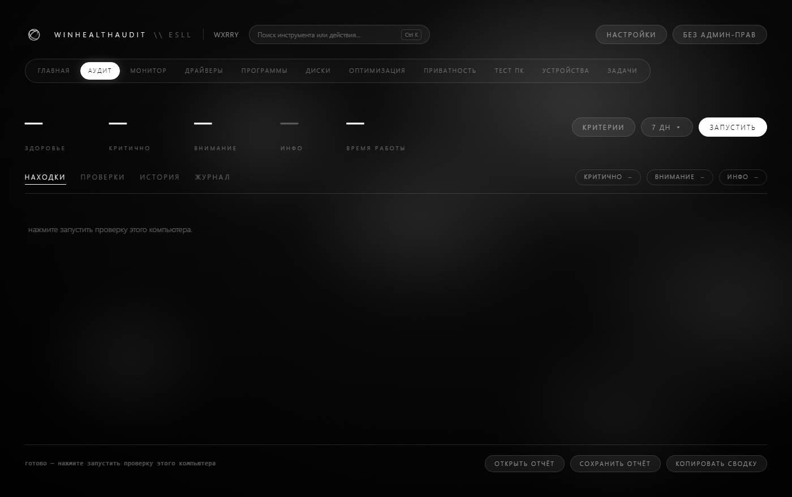
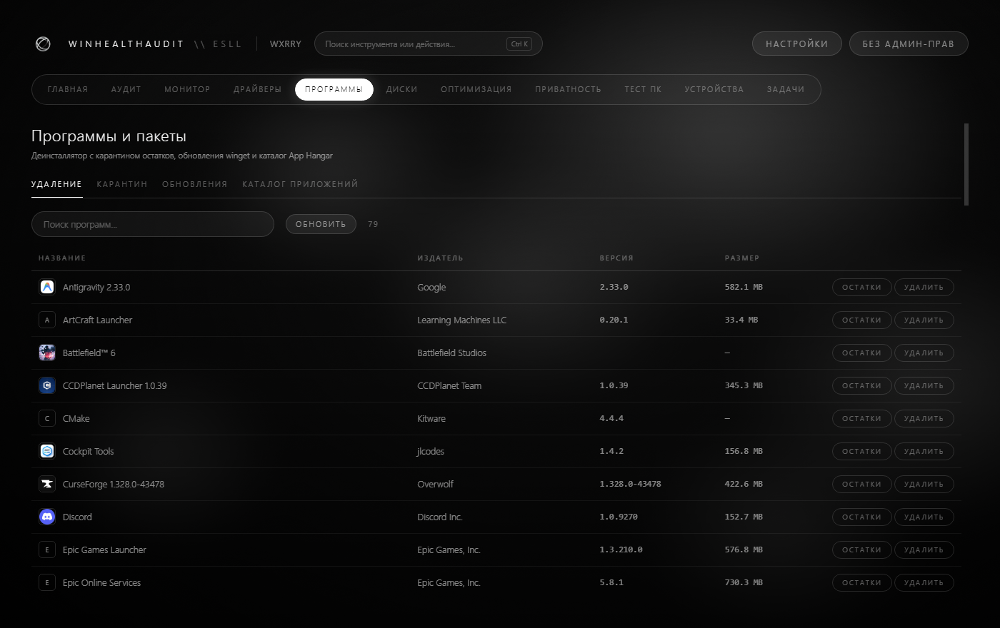
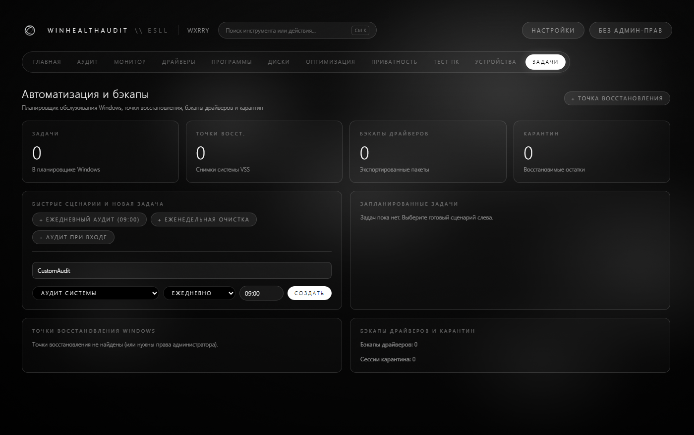
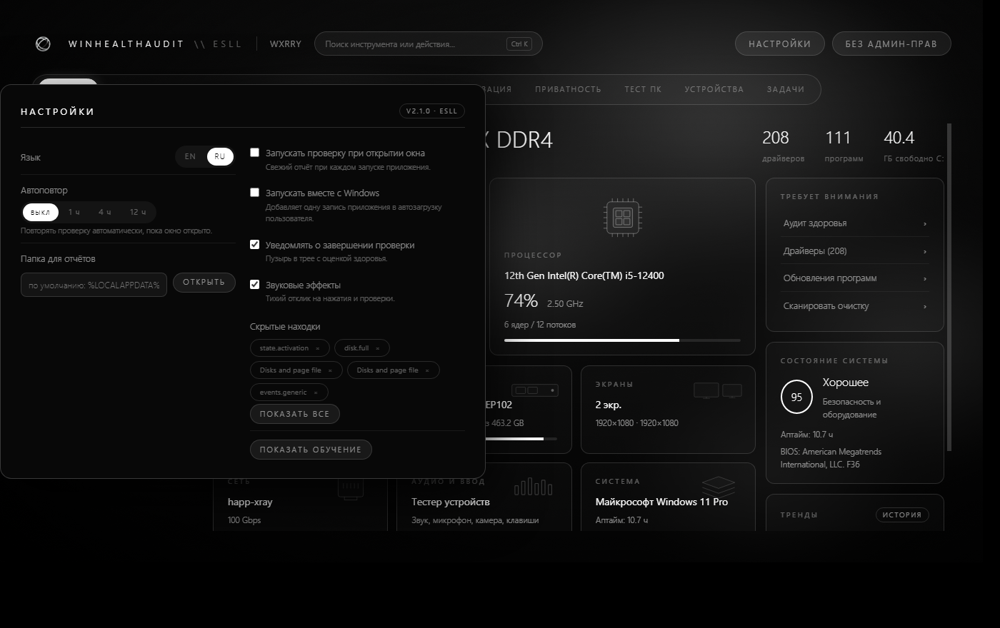
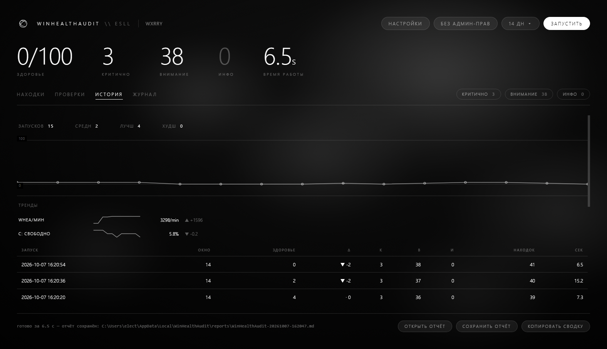

<div align="center">


# WinHealthAudit

**WINHEALTHAUDIT \\ ESLL**

A standalone Windows health audit & PC control center — monochrome editorial UI, EN/RU interface, one installer.


[](https://github.com/wxrrry/ESLL-WinHealthAudit/actions/workflows/build.yml)


**No account. No subscription. No telemetry. Standalone desktop window.**

</div>

---

## Contents

- [What's inside](#whats-inside)
- [Screenshots](#screenshots)
- [Health Audit & Scoring](#health-audit--scoring)
- [Modules](#modules)
- [Installation & Build](#installation--build)
- [Русская версия](#русская-версия)

## What's inside

- **Standalone Desktop App (`WinHealthAudit.exe`)** — runs in its own native Windows `WebView2` window with a dark titlebar, tray icon, and orbital splash screen (independent of browser tabs).
- **Installer (`WinHealthAudit-Setup.exe`)** — monochrome ESLL installer that bundles both `WinHealthAudit.exe` and `WinHealthAudit.Core.exe`, auto-creates the `WinHealthAudit` folder, adds Desktop & Start Menu shortcuts, and registers the app in Windows Search.
- **11-module Control Center** — combines the original read-only 11-check Windows Health Audit engine with live hardware telemetry, driver management, program uninstaller & updater, storage analyzer, optimizer & debloat, privacy & security, benchmarks, device tester, and scheduled automation.
- **EN / RU Interface & Audio Feedback** — instant language switch, `Ctrl+K` command search, and subtle toggleable UI sounds.

## Screenshots

<p align="center">
  
</p>
<p align="center">
  <em>Overview — hardware Bento tiles with monochrome SVG art, live telemetry, system health ring, and audit trends (Health, C: free, WHEA/min, Boot time).</em>
</p>

<p align="center">
  
</p>
<p align="center">
  <em>Audit — 11 read-only checks, health score (0–100) with status grade, scoring criteria, severity filters, and markdown/JSON reports.</em>
</p>

<table>
  <tr>
    <td width="50%"><br><sub><b>Programs</b> — uninstaller with extracted app icons, detail cards, leftover quarantine, winget updater &amp; App Hangar</sub></td>
    <td width="50%"><br><sub><b>Automation</b> — scheduled maintenance tasks, Windows restore points, driver backups &amp; quarantine</sub></td>
  </tr>
  <tr>
    <td width="50%"><br><sub><b>Settings</b> — language (EN/RU), startup, auto-repeat, UI sounds, reports folder &amp; hidden rules</sub></td>
    <td width="50%"><br><sub><b>History</b> — health score over time, per-run snapshots &amp; trend sparklines</sub></td>
  </tr>
</table>

## Health Audit & Scoring

The core engine (`WinHealthAudit.Core.exe`) runs 11 read-only checks (`SystemInfo`, `Hardware`, `SystemState`, `EventLog`, `Disk`, `DeviceManager`, `Performance`, `Boot`, `Processes`, `WheaErrors`, `Gaming`) and computes a **Health Score (0–100)**:

- **Formula**: `100 − (8 × Critical) − (2 × Warning)` (`Info` findings carry 0 penalty)
- **Status Scale**:
  - `90–100` — **Excellent**
  - `75–89` — **Good**
  - `50–74` — **Fair**
  - `0–49` — **Critical**

## Modules

| Module | Capabilities |
| :--- | :--- |
| **Overview** | PC model, OS, uptime, drivers/programs/free space KPIs, live telemetry bars, clickable hardware Bento cards (GPU, CPU, RAM, Storage, Displays, Network), System Health ring & Audit Trends (`Health`, `C: free`, `WHEA/min`, `Boot`). |
| **Audit** | 11 read-only health checks, findings with `NEW` delta badges, expandable 3-line details, rule hiding, History sparkline, live Log, Markdown & JSON report export. |
| **Monitor** | Live CPU, RAM, GPU (load/temp/VRAM), SMART disk health, Wi-Fi/Ethernet, DNS latency test & presets, active processes with End Process / Open Location. |
| **Drivers** | Full signed driver inventory, problem devices, Windows Update driver scan, `pnputil` backup export, System Restore Point creation. |
| **Programs** | Uninstaller with real app icons, detail card (install path, open folder, uninstall command), leftover scanner + Quarantine/Restore, `winget` Updater, and App Hangar catalog & kits. |
| **Storage** | Drive usage overview, folder space breakdown bar, largest files, SHA-256 duplicate finder, safe Recycle Bin deletion. |
| **Optimizer** | Temp & shader cache cleanup, Startup apps manager, Services manager, Power plans, Game Mode / HAGS, Debloat tweaks, SFC / DISM / Network / WU repairs. |
| **Privacy** | Security score (Defender, Firewall, UAC, Secure Boot, TPM), Windows tracking toggles, open listening ports, Camera/Mic/Location permission history, persistence audit. |
| **Benchmark** | CPU single/multi-core, GPU WebGL shader, memory bandwidth, disk sequential read/write benchmarks & saved history. |
| **Tester** | Keyboard actuation visualizer, dead pixel screen test, L/R/Stereo speaker test, microphone level meter, camera preview, mouse CPS test & gamepad visualizer. |
| **Automation** | Scheduled Windows Task Scheduler maintenance presets, System Restore Points, driver backups & quarantine overview. |

## Installation & Build

1. Download **`WinHealthAudit-Setup.exe`** from [Releases](https://github.com/wxrrry/ESLL-WinHealthAudit/releases/latest) and run it (supports `/S /D=C:\Path` for silent install).
2. Or build from source on Windows 10/11 (only built-in `.NET Framework 4.x` `csc.exe` is required):
   ```cmd
   build.cmd
   ```
   Outputs to `bin\`: `WinHealthAudit-Setup.exe`, `WinHealthAudit.exe`, and `WinHealthAudit.Core.exe`.

---

## Русская версия

**WinHealthAudit \\ ESLL** — автономный центр аудита и управления Windows 10/11 в монохромном редакторском стиле с русским и английским интерфейсом.

### Основные возможности
- **Самостоятельное окно (`WinHealthAudit.exe`)** на базе встроенного `WebView2` (не зависит от вкладок браузера) и орбитальный экран загрузки.
- **Единый установщик (`WinHealthAudit-Setup.exe`)** — устанавливает `WinHealthAudit.exe` и `WinHealthAudit.Core.exe`, сам создаёт подпапку `WinHealthAudit`, добавляет ярлыки и регистрирует приложение в поиске Windows.
- **Главная (Overview)** — сводка по ПК, живые графики нагрузки, карточки компонентов с иллюстрациями и деталями по клику, а также блок **Тренды** (здоровье, заполнение диска `C:`, `WHEA/мин`, время загрузки).
- **Аудит** — 11 read-only проверок, формула оценки `100 − (8 × Critical) − (2 × Warning)` со шкалой состояния (*Отлично / Хорошо / Удовлетв. / Критично*), история запусков и отчёты в Markdown/JSON.
- **Все модули управления** — *Монитор*, *Драйверы*, *Программы* (с иконками, карточками путей, карантином остатков, `winget` и каталогом App Hangar), *Диски* (анализ места и дубликаты), *Оптимизация* (очистка, автозагрузка, службы, деблоат, SFC/DISM), *Приватность*, *Тест ПК* (CPU/GPU/RAM/Disk), *Тестер устройств* (клавиатура, экран, звук, микрофон, камера, мышь, геймпад) и *Задачи* (планировщик и точки восстановления).
